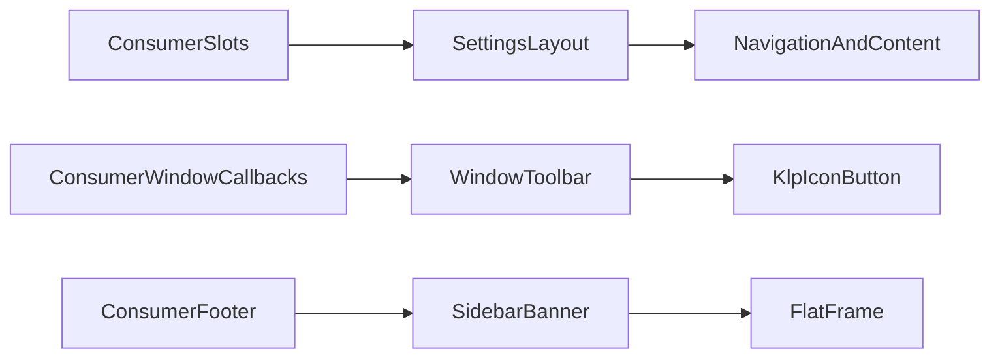

# 桌面工作台呈現組裝

| 定義／檔案 | 職責 |
| --- | --- |
| WindowToolbarProps／WindowToolbar，WindowToolbar.tsx | 三個圖示slot與mini／max／close回呼；只用公開KlpFrame與window tone按鈕，不匯入Electron。 |
| SidebarBanner，SidebarBanner.tsx | leading與actions分置左右，平面Panel及低對比虛線；不定義團隊／帳戶資料。 |
| SettingsLayout，SettingsLayout.tsx | navigation／content／header／notice四個slot；左右22%／其餘的設定雙區與滾動，內容不自加title。 |
| desktop-workbench.css | 共享header drag／控制no-drag、工具列、底部banner與設定視窗幾何；不寫第二份theme或產品狀態。 |

來源：Unico01參考圖與使用者視覺抽取決策，2026-10-18。此為具名模板，不新增公開套件API。複製至Unico/frontend/kallopis需逐字同步。實際多視窗、IPC驗證、dirty攔截及偏好持久化不在本module。設定選單項目由consumer提供，現階段未完成整張報告的所有設定項，不能用slot存在宣稱功能完成。
