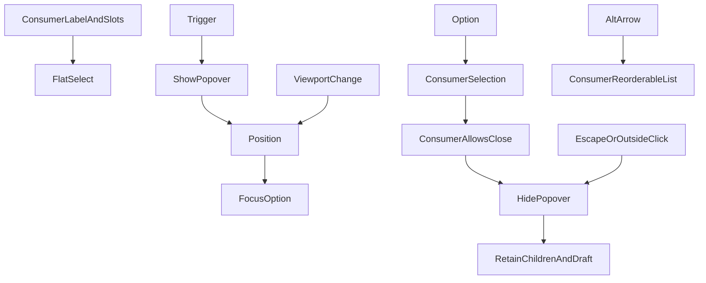

# 平面下拉呈現架構

| 定義／檔案 | 責任 |
| --- | --- |
| FlatSelectProps／FlatSelect.tsx | label 為輔助名稱，valueLabel 是已投影文案，children(close) 保留產品選項，disabled 鎖定操作，indicator 引用 consumer 圖示。 |
| FlatSelectOption／FlatSelect.tsx | children 顯示內容；selected/disabled 投影既有按鈕語意，onSelect 回報操作。固定 data selector 供模板鍵盤尋找，不處理產品值。 |
| FlatSelectGroup／FlatSelect.tsx | children 插槽與低對比細虛線，沒有產品分類資料。 |
| FlatSelect／FlatSelect.tsx | id 關聯控制與popup，trigger/popup refs 指向本機DOM，open 只反映瀏覽器toggle，search.text/at 僅供前綴尋找。關閉不卸載 children。 |
| position | 讀觸發欄位與viewport；空間不足且上方較足時向上，否則向下；寬度與最大高度限制在viewport。 |
| close | 僅在 popover-open 時隱藏，不決定是否捨棄產品變更。 |
| show | 先查明確disabled及fieldset繼承disabled；顯示並定位後，以microtask聚焦目前／首／尾選項。 |
| keydown | Alt/Ctrl/Meta 保留給宿主；Escape關閉返回trigger；上下/Home/End/前綴搜尋在可用選項間移焦點。 |
| trigger onClick/onKeyDown、popup onToggle、effects | 開關及首尾開啟；toggle同步open；disabled關閉；open時訂閱resize與capture scroll，清理時解除。 |
| flat-select.css | field token觸發欄位、透明popup容器、平面KlpFrame與細虛線群組；無第二套theme。 |

來源為 Unico01 平面下拉與清單排序要求。模板只持有顯示／焦點，業務選取、dirty gate、排序與持久化均在 consumer。實際 browser 行為尚未驗收。
