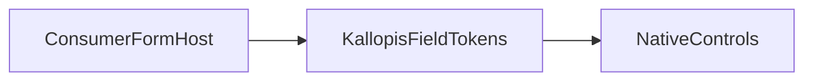

# 表單呈現投影

form-controls.css由klp-form-fields宿主類別界定範圍；原生input（排除checkbox／radio／hidden）、textarea、select只引用正式field配方的高度、padding、border、radius、surfaceInset與focus。textarea為多行高度，標籤與欄位同列結構以垂直呈現統一。

不包含值、驗證、保存、憑證或產品選項；checkbox與radio保留既有互動語意。原生select的OS下拉視窗仍受平台控制；不宣稱已完成自訂Kallopis dropdown。Unico/frontend/kallopis/form-controls.css需逐字同步。
