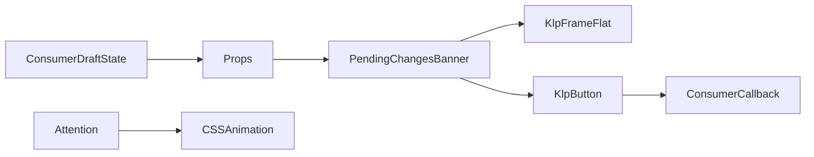

# 待決變更提示呈現架構

| 定義／來源 | 責任 |
| --- | --- |
| PendingChangesBannerProps，PendingChangesBanner.tsx | visible由consumer判定是否有待決資料；attention為提示序號；busy鎖操作；error為必要操作回饋；onSave／onDiscard為回呼，不定義商業行為。 |
| PendingChangesBanner | 沒有變更及忙碌時不渲染；否則以平面Frame、文字與兩個KlpButton呈現。attention key重播CSS震動。 |
| pending-changes.css | Stage底部絕對定位、semantic token、平面／低對比虛線、操作列；180ms兩次水平震動，reduced-motion停用。 |

consumer副本位於Unico/frontend/kallopis，兩檔須逐字同步。資料權威、dirty比較、Store、路由及保存競態不在本模板；不匯入任何Unico程式。驗證：Unico前端TypeScript與bundle；視覺證據及未完成事項留consumer進度文件。
