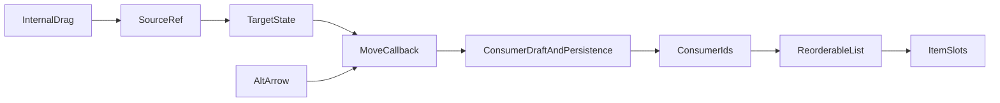

# 可排序清單呈現架構

| 定義／檔案 | 責任與欄位 |
| --- | --- |
| ReorderableListProps／ReorderableList.tsx | ids 顯示身分與順序；label 清單語意；children 項目插槽；onMove 只回報來源／目標；disabled 由宿主決定可操作性。 |
| ReorderableList／ReorderableList.tsx | 受控清單；source ref 只辨識本次手勢，target state 只呈現目標。不自行改 ids 或保存。 |
| clear | dragend/drop 清 source 與 target。 |
| onDragStart／onDragOver／onDragLeave／onDrop | 啟動固定移動手勢、允許內部目標、低對比目標提示、回報後清理；未知外部 payload 不重排。 |
| onKeyDownCapture | Alt+上下方向鍵尋找相鄰 id 並回報 onMove；邊界、disabled 或其他按鍵不處理。 |
| reorderable-list.css | 保持既有清單間距與全寬項目；draggable 游標與細虛線目標，不增加浮起表面。 |

來源為 Unico01 清單可拖動排序要求；只抽出可重用的呈現與手勢投影，無產品資料或商業邏輯。實際瀏覽器拖曳／鍵盤驗證仍待完成。
