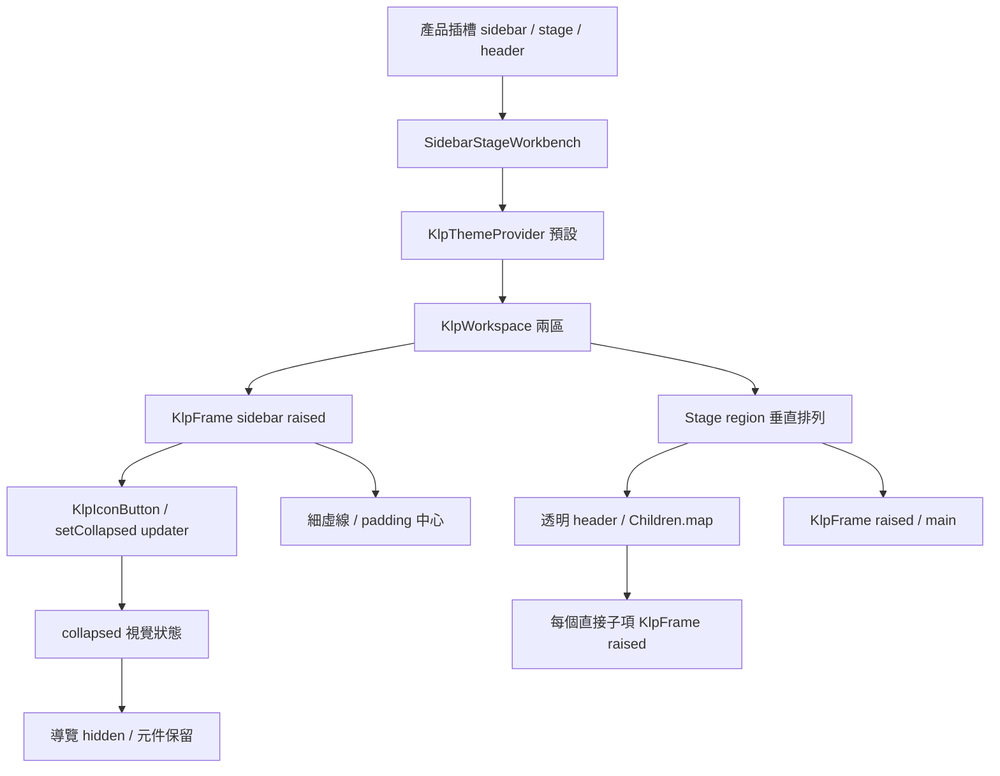

# 雙區工作台組裝模板

本目錄是產品可複製的來源模板，不從 Kallopis 套件公開 export。無新增業務模型或執行系統。

| 定義／來源 | 職責 |
| --- | --- |
| SidebarStageWorkbenchProps | sidebar 提供產品導覽；stage 提供目前工作內容；header 為可省略的直接子項，逐項套用微立體 Frame。 |
| SidebarStageWorkbench | 組合兩區、持有 collapsed；useId 讓每個副本的 aria-controls 不碰撞。收合 updater 反轉狀態，Stage 不卸載；Children.map callback 逐項包公開 raised Frame。 |
| layout.css | 從 Unico 已確認布局抽取幾何並更換產品專用 class 前綴；不複製 Kallopis 陰影／顏色值。navigation-host hidden 隱藏內容及焦點。 |

CSS 自訂欄位：header-content-height 是既有 40px 元件區基準，用於保留 24px 控制；header-bottom-padding 是新選定 4px；header-divider-space 是上下各 4px 的完整分割帶；header-height 將舊底部 8px 換為 4px 再加入分割帶，得到 44px。其他 spacing、divider 顏色、hairline 與寬度讀 Kallopis 語意。

驗證基線：Unico 實際渲染已觀察 header 44px、方形元件 24px、上方及底部到虛線中心各 8px，虛線與右側留白中心同高。複製模板的 TSX 另以 consumer 的 React／Kallopis 型別檢查；模板沒有獨立 runtime 或發布套件。後續調整需在採用產品核對渲染，不把來源複製視為完成整合。

## 清單頭像配方

list-avatar.css：klp-list-avatar固定40px（contentInset×5）方形圓角框，內部icon依contentInset×3置中；由consumer以KlpFrame surface="flat"套用，不包含人物資料或清單排序。Unico/frontend/kallopis/list-avatar.css為逐字副本，清單拖動／排序持久化仍待consumer實作。來源為正式工作台風格配方2026-10-18。

SidebarStageWorkbench新增sidebarHeader／sidebarFooter／windowControls／edgeToEdge slot；collapsed隱藏整個Frame，Stage header重建展開控制，Stage與產品狀態不卸載。Footer只接ReactNode。視窗工具列來自相鄰desktop-workbench；所有IPC／資料權威仍在consumer。
