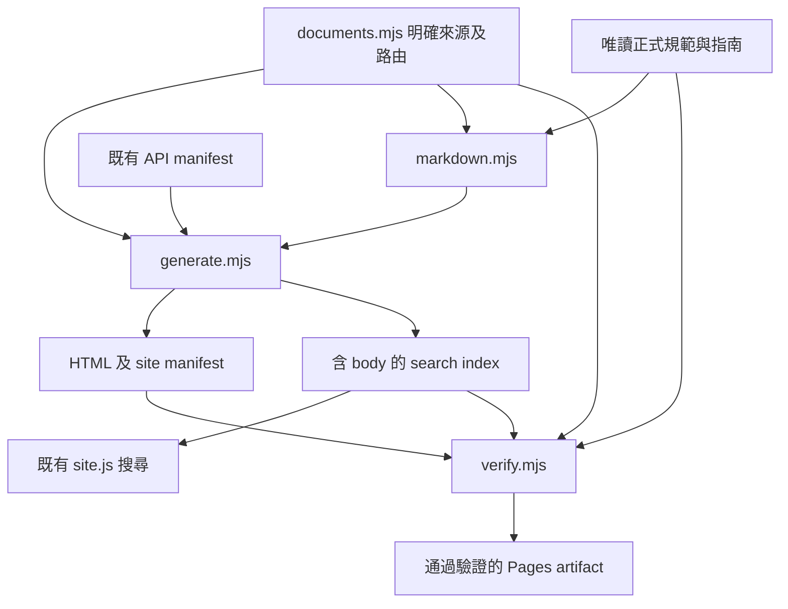
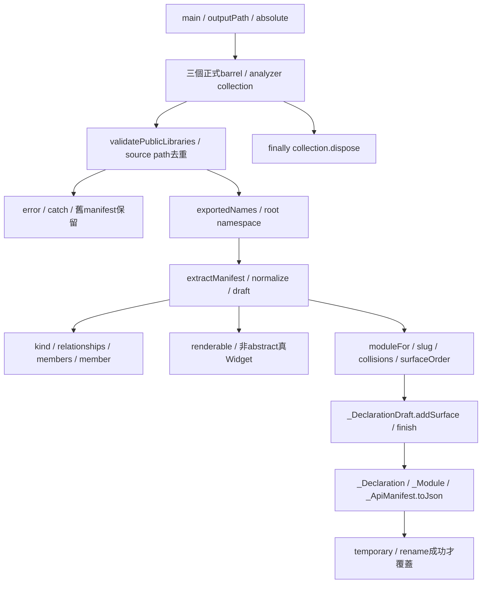
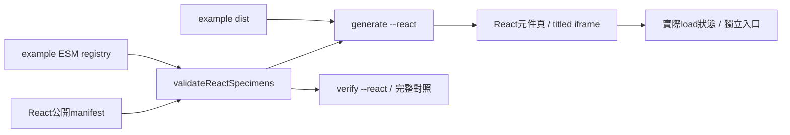

# Kallopis Reference Site

## DOCS-LINEAR-1（完成）

修訂 `DOCS-LINEAR-r1`。將已實作雙框架尺寸算法的共通來源 `docs/architecture/workbench-linear-contract.md` 接入 `docs/guides/workbench-linear-contract.html`，Guide 分類。BUILD write_paths 只有 `tool/reference_site/documents.mjs`；既有 renderer、API identity、manifest、architecture、tests 與來源正文唯讀。沿用現有 15 項 registry／內容／link checks 及 generate／verify，不新增測試；本次 docs 路由不改展示功能。M1：來源、頁面、搜尋及引用可驗證。cold-start 1k–2k tokens／5–10 分鐘，參照 DOCS-STAGE-1；超過 3k tokens 或需要修改 renderer 回 PLAN。

## 本階段規範導覽切片

修訂 `DOCS-STAGE-r1`，DOCS-STAGE-1 完成。只將已接受的 Workbench、Style Pack、互動 docs、研究與整合計畫 Markdown 加入現有 documents registry；write_paths 僅 `tool/reference_site/documents.mjs`。資料仍從 Markdown 生成，公開 API identity／現有頁面／測試／style 不改。15 項既有網站 tests、519 canonical API 頁／25 文件 generate／verify 通過；本切片不宣稱已嵌入互動展示。

冷啟動估算 1k–3k tokens／5–15 分鐘，參考 TDS-VISUAL-1 的 registry 接入，Node24 builtin，無新相依。唯一里程碑 M1：五份來源的頁面、搜尋及本地引用可驗證；超過 4k tokens 或 20 分鐘先查來源／路由契約，不扩寫 UI。BUILD 的 architecture、tests、fixture、API manifest 及其他 module 都唯讀。

目前架構修訂：`TDS-VISUAL-r1`，IMPLEMENTED（2026-10-11）。通用視覺網頁整合已通過 11 項新契約檢查及 4 項既有 API 檢查，正式 515 API 頁／18 文件生成及 verifier 通過；桌面索引、配方搜尋與窄畫面表格已觀察。感官品質等待人類接受。

## 目的與非目標

本 module 將正式通用視覺 Markdown、目前產品指南與三個 public Dart barrels 的 manifest 產生為 GitHub Pages。讀者從 docs 選擇通用視覺規範或目前 Flutter Reference；公開 API 仍為一個 canonical declaration 一頁。

不建立 declarative／compatibility 區，不恢復已刪除文件、Catalog migration、runtime 或 architecture atlas；不修改 Flutter 元件、public exports 或視覺契約。

## 公開輸入與輸出

| surface | entrypoint | 網站標示 |
| --- | --- | --- |
| `theme` | `package:kallopis/kallopis_theme.dart` | Stable Theme |
| `foundation` | `package:kallopis/kallopis_foundation.dart` | Stable Components |
| `experimental` | `package:kallopis/kallopis_experimental.dart` | Experimental |

輸出固定在 `build/reference-site`，包含首頁、開始使用、module 索引、每個公開 declaration 頁、搜尋資料與 `site-manifest.json`。GitHub Pages workflow 只上傳通過 verifier 的 artifact。

## Manifest 與 declaration identity

Extractor 以 Dart analyzer 一次解析三個 surface，任何 entry 缺失或 analyzer error 都失敗且不留下部分 manifest。Manifest schema v1 頂層為 `schemaVersion`、`surfaces`、`modules`。

Canonical declaration identity 是 `sourceUri + publicName`。相同來源宣告跨 surface 只保留一筆並列出全部 surface；同名不同來源各自保留。一般 URL 為 `docs/api/<module>/<name-slug>.html`；同 module 內名稱碰撞時追加 `--<primary-surface>`，仍碰撞則 extraction 失敗。

Module 由來源 URI 分成 `application／capabilities／composition／features.*／foundation／kernel／rendering／runtime／styling`；目前三個 public barrels 實際未匯出的 module 仍可在索引顯示 0，但不得從 private source 推定 public API。

## 網站與驗證責任

- API 首頁列出三個 surface、stability、import 及所有 module。
- Module 頁列出全部 canonical declarations、kind 與可達 surfaces。
- Declaration 頁列出 surface imports、source URI、signature、型別關係、constructors 與 public members。
- Search 與 site manifest 以 canonical `id` 對應頁面，不以名稱去重。
- Verifier 雙向比較 manifest、module page、declaration page、search 與 site manifest，拒絕缺頁、多頁、額外 API 頁、漏 surface、private/declarative surface 或錯誤 identity。
- Product guide、README、Single Architecture、frontend boundary、style 與 KLP-0022 是 current docs；已刪歷史文件不恢復。

## 依賴方向

```text
public Dart barrels → analyzer manifest → static generator → verifier → Pages artifact
current Markdown ────────────────────────┘
```

本機以真實三個 barrels 與 analyzer 更新 `reference-api.json`。Krepis 遠端尚未包含 Kallopis path dependency 所需 bindings，因此 Pages workflow 使用已提交、已通過本機 extraction／verification 的 manifest 執行 test、generate、verify；不得在 workflow 失敗時沿用上一版 build artifact。Dart library 不依賴網站 manifest。

## 已實作基礎

`TDS-REF-T/D/I` 已完成。原架構紀錄於 2026-09-20 使用三個真實 public barrels 產生並驗證 17 個 module、515 個 canonical declaration 頁，既有 tests 為 4/4；本次 PLAN 沒有重跑，這些是先前紀錄，不是本次驗證結果。

## 目前 stage：通用視覺規範整合 v1

需求來源：[網站規格](../../spec/reference-site-v1.md) 的 VDOC-01～05，以及 [共通規範維護契約](../../docs/design-tokens/maintenance.md)。本 module 只讀共通內容；網站來源、路由、渲染、搜尋及完整性由本 module 擁有。

### 來源與路由契約

由 `documents.mjs` 維護唯一明確來源清單，generator 與 verifier 共用，不掃描整個 docs／spec，也不收錄 `.agents`。原八份文件與其 `docs/guides/` 路由保留。每筆來源包含 `source`（repository 相對 Markdown 路徑）、`href`（產物相對路由）、`title`（導覽名稱）、`category`（區分規範、指南或快照）。八份正式規範如下：

| 來源（位於 `docs/design-tokens/`） | 網站路由 |
| --- | --- |
| `KALLOPIS-DESIGN-MAP.md` | `docs/design-system/index.html` |
| `maintenance.md` | `docs/design-system/maintenance.html` |
| `notation.md` | `docs/design-system/notation.html` |
| `primitives.md` | `docs/design-system/primitives.html` |
| `semantics.md` | `docs/design-system/semantics.html` |
| `recipes.md` | `docs/design-system/recipes.html` |
| `examples.md` | `docs/design-system/examples.html` |
| `platform-notes.md` | `docs/design-system/platform-notes.html` |

索引引用的 `docs/design-tokens/README.md` 另產生 `docs/design-system/export-snapshot.html`，標示匯出快照；它不列為正式章節，也不與正式規範競爭搜尋分類。`spec/multi-framework-design-system.md` 產生 `docs/guides/spec-multi-framework-design-system.html` 供核心目標連結使用。JSON／CSS／ZIP 不在本 stage 產生下載或同步功能。

`site-manifest.json` 保留 API 欄位及 `guides`，新增 `documents` 對應上述來源清單；既有 API identity 與 schema 不變。必要來源缺失須在清理輸出前失敗；不得繼續跳過缺檔並產生看似完整的站點。

### 責任與依賴

| 位置 | 責任 |
| --- | --- |
| `documents.mjs` | 唯一來源清單、source → route、頁面分類；不含正文副本 |
| `markdown.mjs` | 將 Markdown 的標題、段落、列表、表格、code、基本 inline 記號與連結轉為安全 HTML，並提供該頁純文字搜尋內容與 anchor 集合 |
| `generate.mjs` | 原有 API 產生流程；讀取已登錄 Markdown，使用 renderer 產生章節頁與搜尋資料，發布 site manifest |
| `layout.mjs` | 沿用共用 shell，接入通用視覺導覽及更新專案定位；只將目前 API 標為 Flutter，不宣稱其他框架已實作 |
| `static/site.js` | 延用既有搜尋流程，查詢 title／category／href 及新增 body 內容；獨立顯示規範分類 |
| `static/site.css` | 原有 table 與窄畫面樣式優先沿用；僅在實際渲染顯示必要缺口時局部修改 |
| `verify.mjs` | 保留 API 雙向檢查；另外比對 registry、documents、實際頁面、搜尋內容與本地連結／anchor |



Renderer 只支援現有來源所需的 Markdown 子集，維持零新增執行相依；不建立通用文件 CMS 或設計 token compiler。表格需要處理 cell 內 inline code 及 escaped pipe；來源的 pipe 不能被誤切。HTML 原文視為文字並 escape，link 僅接受本地相對目標、anchor 及允許的外部 URL，不產生可執行 URL。

已登錄 Markdown 相對連結按來源目錄解析，再轉為相對產物路由；保留並驗證 fragment。未登錄 Markdown 連結使用明確原文連結，不產生不存在的 HTML 路由；不得自動納入整個歷史決策樹。未登錄連結的遠端可達性不屬於本地 verifier 的成功宣稱。生成 anchor 支援中文並處理重複標題。

每個文件只有一筆搜尋記錄，新增 `body` 為該 Markdown 渲染對應的純文字；`href` 指向章節，不承諾逐 token 專屬頁或逐列搜尋結果。既有 API 記錄及其 `apiId` 不變。無結果與載入失敗仍沿用既有提示。

選擇「明確 registry＋共用 renderer」，因為來源有限、要保留既有 API、且真正缺口是表格與連結。不採用另一個網站框架／CMS，避免雙站點、重新維護風格與引入非本 stage 必要的發布配置。未來框架 reference 可另行接入；本 stage 不設空目錄或通用插件系統。

### 寫入範圍與保護路徑

唯一垂直 slice 為 `TDS-VISUAL-1`，交付從 docs 入口 → 分章閱讀 → token／recipe 搜尋 → 完整性驗證的可本地預覽結果。

Implementation `write_paths`：`tool/reference_site/documents.mjs`、`markdown.mjs`、`generate.mjs`、`layout.mjs`、`verify.mjs`、`static/site.js`、`static/site.css`、`README.md`。以上除完整首項外均以 `tool/reference_site/` 為根。

Test Author 只可新增 `tool/reference_site/test/design_system_docs.test.mjs` 與專用 `tool/reference_site/test/fixtures/design-system/**`；既有 tests 與 API fixture 唯讀。新測試由獨立 Test Author 階段撰寫，Implementation 不得修改或弱化。規範、`architecture.md`、Dart 元件、API schema／extractor／committed manifest、其他 module 與 `.github/workflows/**` 均為 Implementation 唯讀。

產物僅寫入既有 ignored `build/`。BUILD 前必須取得含這次已接受規範與 PLAN 文件的乾淨隔離工作樹，記錄其真實 `base_revision`，再依 Task Packet schema 產生 packet；不可直接把有他人變更的主工作樹當成隔離環境，也不可為此 reset 或 stage 主工作樹。PLAN 本輪不建立偽造 revision 的可執行 packet。

### P1 對應與驗收

| P1 | 擁有責任 | Slice 證據 |
| --- | --- | --- |
| VDOC-01 | layout／generator／導覽 | docs 首頁和無 JS 的初始導覽可到規範；Flutter API 既有路由仍存在；桌面與窄畫面可操作 |
| VDOC-02 | registry／renderer | 八份正式文件頁、快照頁及目標頁與來源對應；相對 HTML 路由與 fragment 檢查；在 `/Kallopis/` 前綴下瀏覽 |
| VDOC-03 | renderer／既有 CSS | 真實規範表格列與 cell 內容涵蓋檢查；code／色碼／公式不被剝除；觀察窄畫面表格及鍵盤操作 |
| VDOC-04 | generator／site.js | 兩個指定查詢可到正確章節；無結果與載入失敗行為；API 搜尋 identity 保留 |
| VDOC-05 | generator／verifier | 故意缺來源、移除章節頁、加入未登錄規範頁、破壞本地連結／anchor 或移除搜尋 body 皆被拒絕；原 API tests 保持通過 |

新 deterministic tests 的必要風險是文件轉換會靜默遺失表格／引用，以及驗證器可能漏查新文件。Test Author 應以代表性輸入與真實規範整合入口定義預期，不複製 renderer 演算法，也不引入視覺 baseline。目前 Red 未執行；Yellow 為新文件入口；既有 API code 為保留的 Green，透過現行 module tests 維持既有閘門。

既有 module gate：`npm test --prefix tool/reference_site`；之後使用既有 committed manifest 產生網站，再執行 `generate.mjs`／`verify.mjs`。不因本次網站修改執行 Flutter 測試或重新擷取 API。測試可能改寫 build 內容，須在 tests 結束後以正式輸入重新產生預覽，不把 fixture 網站當交付。

桌面／窄畫面的渲染、導覽、搜尋與表格操作須實際觀察；視覺品質及易用性仍為 human-pending，不用 golden 或 agent 評分替代人類接受。若無法執行瀏覽器驗證，必須明示缺項。

### 里程碑與估算

估算 basis：cold-start；參考 `TDS-REF-D/I` 的工具範圍，沒有可用實際耗時可當精準歷史估算。整個 slice 預估 8k–16k tokens／40–90 分鐘；假設沿用目前模型與本地 Node 24、既有網站、不新增相依、不變更來源內容。這是後續執行預算，不是本輪已用量。

| 里程碑 | 可用成果與證據 | 累計預估 | 異常門檻 |
| --- | --- | --- | --- |
| M1 契約檢查 | Test Author 建立表格／連結／搜尋／verifier 的局部 checks，記錄未實作的 Red；工作樹與 packet 範圍確立 | 2k–4k tokens／10–25 分鐘 | 需要改來源內容、API fixture 或公共 schema 即回 PLAN |
| M2 分章網站 | 正式來源能生成與搜尋；M1 checks 和既有 module tests 通過 | 6k–11k tokens／30–60 分鐘 | renderer 所需特性超出現有來源子集，或耗時超過 60 分鐘仍不能產生完整章節時先定位範圍 |
| M3 可驗證預覽 | 正式網站 generate／verify、缺項拒絕、本地前綴預覽與桌面／窄畫面觀察，scope checker 通過 | 8k–16k tokens／40–90 分鐘 | 需要發布、改 workflow 或改其他 module 即回 PLAN |

每個里程碑完成後記錄成果、證據、修改路徑、可取得的實際用量與偏差；不報偽造的精確 token 用量。

### PLAN gate

VDOC-01～05 均已完成 deterministic module gate；資料由唯讀規範流向網站，沒有反向設計權威。保護測試 SHA256 未變；TDS-VISUAL-1 scope checker 通過，無違界修改。後續根目錄重組的 extractor 路徑及新增 React 指南由 integration owner 維護，不屬原實作切片。

## 函式責任索引

| 來源 | 函式及責任 |
| --- | --- |
| `generate.mjs` | `main` 預檢／產生／清冊；`validateManifest` API identity；`moduleRoute`／`declarationRoute`／`relative` 路由；`write`／`page` 產物及 shell；`escapeHtml` escaping；`slug` 既有 API slug |
| `markdown.mjs` | `renderMarkdown` 文章與 anchor；其 `closeList` callback 關閉列表；`cells` 安全表格分欄；`inline` 保留 inline 記號；`linkTarget` 來源連結對應；`headingId` 中文 anchor；`escapeHtml` 防止原文執行；`plainText` 同內容搜尋投影 |
| `layout.mjs` | `head` metadata／CSS；`header` 主導覽與偏好；`footer` 來源；`scripts` 行為入口；`shell` 文件布局；`homePage` 首頁 |
| `verify.mjs` | `files` 掃描產物；`modulePage`／`declarationPage` API 路由；頂層流程執行 API／文件／搜尋／link 雙向檢查及報告 |
| `static/site.js` | `applyPreferences` 偏好接入；`appendLink` 文字安全連結；`appendDetails` 分組；`render` 內容搜尋與導覽；change／click／keydown callbacks 管理偏好；fetch success／failure 分別保留搜尋結果與失敗提示；TOC 依現行 DOM heading 產生；Mermaid callback 失敗保留原文 |

`documents.mjs` 僅有資料投影與 route Map，無類別。資料物件的 source／href／title／category 含義見上方契約；renderer 的 html／body／anchors 與 search body 是同一份文件的不同輸出投影，不能單獨手寫。

整合owner更新：Flutter extractor 從 `flutter/lib/` 解析公開入口；命令core公開七個宣告後重新extraction，當前541 canonical API／17modules／三surfaces。documents.mjs新增共同命令契約的唯一Guide路由 docs/guides/workbench-command-contract.html，並讀更新的雙框架使用指南；當前28份Markdown來源。generate／verify與15項既有registry/內容/link checks通過；manifest只從Green extraction同步，沒有手改API identity。網站仍缺全部元件互動specimens與GUI bundles，不能用541頁清冊宣稱互動展示完成。

DOCS-LINEAR-1 實作 3cfe2eea：15 項既有 checks、524 canonical API／17 modules／26 文件 generate／verify、scope gate 通過。公開 manifest 重新 extraction 後由整合 owner 更新，不由 BUILD 手改。

React registered command入口契約加入唯一Guide路由 docs/guides/workbench-command-entry-contract.html；當前29份Markdown，541 API清冊不變。generate/verify及15 checks通過。React入口12項DOM/lifecycle/type checks不代表browser展示完成。

Flutter registered toolbar/menu/ref/kind四個公開宣告extract後，當前545 canonical API／17modules／三surfaces，29Markdown。公開manifest只同步Green extractor輸出；兩框架入口完成仍不等於specimen/GUI/palette/shortcut完成。

當前網站來源：新增共同palette Guide及React產品使用說明，31Markdown／547canonical API／17modules／三surfaces；generate、verify及15既有網站checks全部通過。React CommandsDemo提供公開consumer實際browser證據，尚未接成每個component專屬網站specimen；Flutter palette公開enum／Widget已由Green extractor接入；Flutter consumer展示與三GUI×兩框架仍待交付。

共同ENTRY-GEOMETRY-r1前置契約加入唯一Guide路由；当前31Markdown／547API。此READY只規範命令入口有限幾何，不宣稱實作或popup已完成。

popup雙框架library與公開consumer已完成；公開popup與兩端usage由正式Markdown接入，canonical identity直接取extractor，全部元件互動、React專屬清冊與GUI bundle仍另stage。

快捷鍵純核心WB-SHORTCUT-CORE-r1已完成並由documents.mjs接入Guide；原生宿主WB-SHORTCUT-HOST-r1已實作，不能將core或Guide當作native keyboard／互動展示完成。

雙框架快捷鍵purecore完成後，Flutter重新Green extract560 canonical declarations／17modules／三surfaces，34Markdown；Guide及兩端usage明示native adapter pending。新清冊採extractor產物，未手改identity。

共同原生宿主Guide直接讀正式來源；Flutter host完成後Green extract561 canonical API／17modules／三surfaces，34Markdown。protected Flutter10／React6 checks證據與nativebrowser pending分列；全部互動元件、React清冊與GUI仍後續。

當前consumer增量：React e56976aa／Flutter f9118c25已完成原生快捷鍵、作用域與衝突、錄製重綁／設定及原草稿；不以各總覽Commands demo替代元件頁specimen。兩端usage由正式來源生成；561API／34Markdown generate/verify Green。下一owner工作為各renderable public component對應唯一互動registry、React manifest與兩端靜態bundle，覆蓋閘門與路由依interactive-docs-v1。

## FLUTTER-REFERENCE-RENDERABLE-1（COMPLETE）

修訂FLUTTER-REFERENCE-RENDERABLE-r1，依共同IDOC-FLUTTER-RENDERABLE-r1，BUILD唯一write extract_api.dart。保留所有canonical identity／kind／slug／signature／members，schema1 declaration新增必填renderable bool，由真實ClassElement的isAbstract與Widget來源identity/allSupertypes判定。只依各root exportNamespace取得publicclosure，不繞過show/hide追回被隱藏symbol。abstract final/base與sealed不要求實例；具體modifier均可。未知資料／enum／extension／mixin或fakeWidget false。

CLI只在成功完成全manifest後寫既有ignoredoutput，錯誤保留原檔。此slice不改公開Widget／tests／fixtures／registry／example／generator／verify／config／committedmanifest。必要獨立Test Author只write test/extract_renderable.test.mjs，透過CLI暫存三個public barrels及既有Flutter package_config，保護all-modifiers/inherited/fake/abstract/type-data/public show-hide/exclusion/跨surface去重與失敗保留原檔；不讀實作、不固定真实數量、不snapshot目錄。既有15websitechecks沿用，不新增視覺tests。

cold3k～6k/20～40分鐘，參照REACT-REFERENCE-COMPONENTS-1；M1獨立CLIfixtures可執行且记录有效Red（3k20）；M2同protectedchecks Green/publicanalyze/真實extract/scope1（6k40）；8k55或跨source改動回PLAN。TypeScript extractor屬React獨立module完成；此旗標還不是Flutter全部專屬route完成。感官human-pending。

### Renderability 實作證據（COMPLETE）

BUILD c7a841aa exact1source，protected4checks Green（fresh author69b52e95，SHA256 A51481D0B5E16B4AFD2D699DB92AD8CFB78046125F2292FD9B02FC867B910C7A），scope1/diff Green。Source等同副本置於Flutter package context分析No issues；直接root analyze沒有package config而失敗屬環境，沒有改config或放寬檢查。原生CLI fixture採真實Flutter Widget及間接／各class modifier、abstract／同名fake／data、show/hide／跨surface及失敗保留原檔。初次fixture mixin implements Widget的Object.toString不符Diagnosticable簽名，作者只補官方DiagnosticLevel與相容override三行，原斷言保留。

原全量extract被dev analyzer10.1不支援Dart3.12私有具名參數阻擋，已由FLUTTER-ANALYZER-RUNTIME-1 c84bd254精確更新analyzer13.0.0/_fe_analyzer_shared100.0.0；SDK／CI／meta1.18.0及公開元件不變。13.0既有公開API可直接使用，不需為計畫新增adapter或修改source。新runtime下同protected4checks全部Green（93.1秒），等同source分析No issues，真實extract561 canonical declarations／17modules／三surfaces／273 renderable（259 class＋14 finalClass），identity增刪0、所有561都有boolean。正式manifest只採成功extract，沒有固定數量快照或跳過diagnostics。元件query routes、registry/bundle及coverage仍另stage。

| extract_api.dart 類別 | 全部責任及方法 |
| --- | --- |
| _SurfaceDefinition | name／entrypoint／path／stability正式入口資料，constructor／toJson映射surface，path只供CLI |
| _ApiManifest | surfaces／modules唯一整體，constructor、declarationCount fold數實際declarations、toJson輸出schema1 |
| _Module | name分類與declarations清單，constructor／toJson投影 |
| _DeclarationDraft | id／name／baseSlug／kind／module／sourceUri／signature／documentation／typeRelationships／members來源草稿；renderable analyzer旗標；surfaces跨入口合併。constructor、primarySurface、addSurface按正式次序合併、finish建立完成DTO |
| _Declaration | canonical id／name、碰撞後slug、kind／module／sourceUri、primarySurface／唯讀surfaces、原signature／documentation／typeRelationships／members及renderable；constructor／toJson不建立第二分類權威 |
| _Member | name／kind／signature／documentation公開成員，constructor／toJson |

| extract_api.dart 函式／callback | 實際責任 |
| --- | --- |
| main | 驗證入口、同collection解析roots、validate公開匯出來源、extract後temporary/rename輸出；catch原診斷非零，finally dispose |
| _outputPath／_absolute | 嚴格CLI output參數與平台絕對路徑 |
| _validatePublicLibraries | 以來源path去重、解析每個本庫public export library、全units error拒絕；只追本庫exports，不掃外部Widget source |
| _exportedNames | root exportNamespace現成closure，保留show/hide，不追回子library隱藏名字 |
| _renderable | ClassElement非abstract且allSupertypes真正Flutter Widget source identity；fake／data／其他false |
| _extractManifest | 各surface公開名稱、normalize、canonical去重、draft、module/slug碰撞檢查及排序 |
| _normalize／_draft | synthetic getter回原variable；原symbol生成完整草稿／analyzer renderable |
| _kind／_relationships | 所有class modifiers等原分類與extends／mixins／implements投影；不以kind決定renderable |
| _members／_member | 公開constructor／field／method／accessor成員與原signature/docs，依名稱及kind排序 |
| _moduleFor／_compareModules／_surfaceOrder | 限本庫package URI／根module／features子類，正式module及surface次序 |
| _slug／_documentation | 穩定slug與原doc comment標記清理 |
| nested callbacks | diagnostics flatten/filter；runtime symbols排序；surface/module/member映射及碰撞計数；supertypes identity、exports篩選；JSON toJson map/fold；正則slug替換與doc逐行處理，均屬上述caller資料投影 |



## DOCS-ANALYZER-API-1（COMPLETE：相容性驗證）

修訂DOCS-ANALYZER-API-r1，依integration相容性契約，FLUTTER-ANALYZER-RUNTIME-1已完成；既有extract_api.dart直接相容analyzer13公開element/namespace API，沒有必要的source變更，完成同protectedchecks與全量擷取驗證，不導入privateAPI、改JSONschema、改publicexports或忽略diagnostics。保護renderable/show-hide/all-modifiers/canonical/failure同4checks hashA51481...維持；必要same-source分析與真實完整extract新manifest，與舊561 identity比較visibility改正；scope1/diff。成功後由owner同步正式清單與generate/verify/網站既有15checks；Flutterconsumer／generator coverage仍後stage。

cold1k～4k/15～30分鐘；M1 compile/同4Green（2k20），M2 actualextract/identity/scope1（4k30），6k45或新的API契約返回PLAN。不以最初fixtureGreen替代新的全量成功，舊manifest維持直到成功。

## DOCS-TEST-RUNNERS-1（COMPLETE）

修訂DOCS-TEST-RUNNERS-r1，保留15項純Node網站checks，獨立4項analyzer CLI checks需要Flutter SDK與package_config。Pages現有runner只有Node，不能隱性要求整個Flutter/Krepis環境；BUILD只write package.json scripts：test明列原兩個website test檔，test:extract明列extract_renderable.test.mjs，extract/build/verify及其餘設定保持。不得skip或刪斷言；SDK checks由已安裝Flutter及pubget的CI root job強制执行（另一CI module slice）。fresh TestAuthor只改launcher portability，Linux PATH dart／Windows既有bat或KALLOPIS_DART明示入口，不跳過缺失SDK。此分開環境責任不是放寬測試。

cold1k～2k/5～15分鐘，單M1：npm test為原15Green；同新portable SDK check4Green；scope1/diff。3k20或要修改tests／workflow回PLAN。

BUILD37bad812 exact package.json；新入口 npm test 原15/15 Green、npm run test:extract 原4/4 Green（93.5秒，Windows），兩者零skip。獨立launcher1c322b4d hash AA12D3B695D46B6E048CC0DBC78ECD5A4BF4AB03B6470DA7EFC1B4F4DA90675C，Linux PATH入口尚待remote Ubuntu CI；不以本機結果代替Linux證據。scope1及diff Green，extract/build/verify保留。

## DOCS-REACT-SPECIMENS-1（READY）

修訂DOCS-REACT-SPECIMENS-r1，依IDOC-COMPONENT-REGISTRY-r1與example公開reactSpecimenRegistry。當前stage只接完整React公開元件到網站；Flutter全量與GUI、風格audit仍原goal後續，不能把React完成稱全部網站交付。BUILD exact generate.mjs、verify.mjs、新react-specimens.mjs、static/site.js、static/site.css。CLI generate/verify新增可選--react；不帶旗標保留原Node15網站用途；帶旗標必須讀fresh react/build/reference-components.json、example公開ESM registry及example/dist/index.html bundle，在清理輸出前完整validate，缺項／幽靈／非法canonical／schema／重複name/id／無實際factory種類皆拒絕。後续CI owner在bundle pipeline完整後接mandatory旗標，不能藉optin聲稱最終gate完成。

公開pure validateReactSpecimens(inventory, registry)回傳name排序的component DTO加href（docs/react/components/<encodedName>.html）；id為@kallopis/react#name，schema1/framework react/entrypoint @kallopis/react/components陣列，source/signature/propsType字串；registry五種basic/layout/command/dock/theme與清單雙向相等。renderReactSpecimen(component, bundleUrl)回傳公開signature／入口及帶title iframe、獨立開啟link與data-specimen-state狀態；輸入文字escape，URL由generator相對路由提供。生成React索引及每component canonical頁，search category React Component/id，site manifest reactComponents；copy bundle至examples/react，保留assets/package fonts。docs中心加入React索引連結。現有FlutterAPI identity／documents保持。

verify --react從同輸入重新validate，要求site清單/頁/search/iframe title及對應query、local bundle入口和assets存在；拒絕額外React頁。browser status實際iframe load同源檢查doc/body/error route，明確loading/loaded/error及timeout，獨立link可恢復；不用sandbox阻擋clipboard/keyboard/drag，iframe width100% height720有自身scroll。新增CSS只配置docs frame，不改庫風格。

Test Author獨立write test/react_specimens.test.mjs，保護pure跨module清單與escaping/rendered query/title/link，不snapshot固定數量/私有實作、不改舊tests。BUILD不可改tests/config/workflow/example/library/architecture。必要新checks、原15、--react generate/verify、native頁內props/result/style/reset及prefix/direct-refresh/fonts、scope5/diff。感官human-pending；實際窄browser另驗證，local320不能替代。估6k～12k/45～90分鐘，參照前registry及網站15checks；M1 contract/build/generate（6k45），M2 protected/native/prefix/scope（12k90）；18k120或外module需求返回PLAN。

| source／function | 責任 |
| --- | --- |
| react-specimens.mjs validateReactSpecimens／renderReactSpecimen | 公開清單與example registry契約、可安全嵌入的公開HTML |
| generate main --react | 前置驗證、相對頁路由、bundle copy、索引/search/manifest |
| verify --react | 對正式輸入重新完整校驗頁面與bundles，不信任產物自述 |
| site.js iframe status handlers／site.css frame | 同源載入狀態及文件展示容器，產品狀態由example擁有 |


